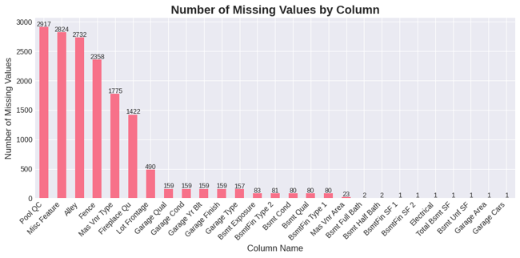
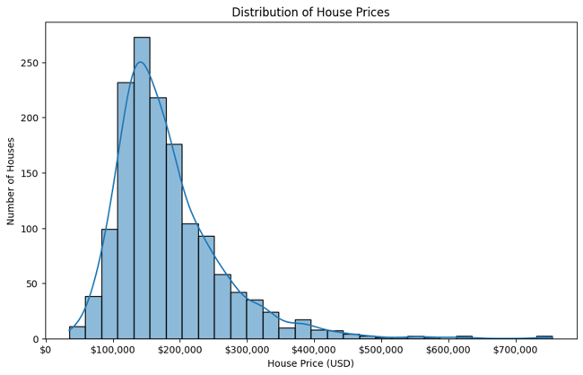
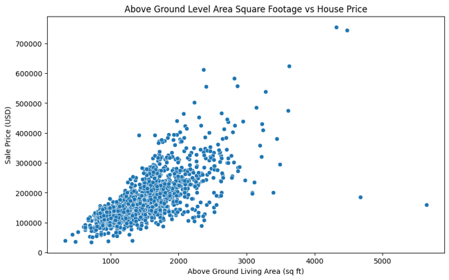
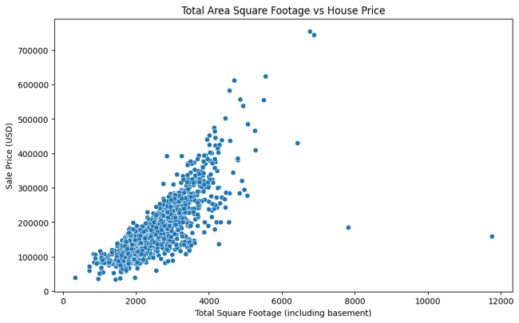
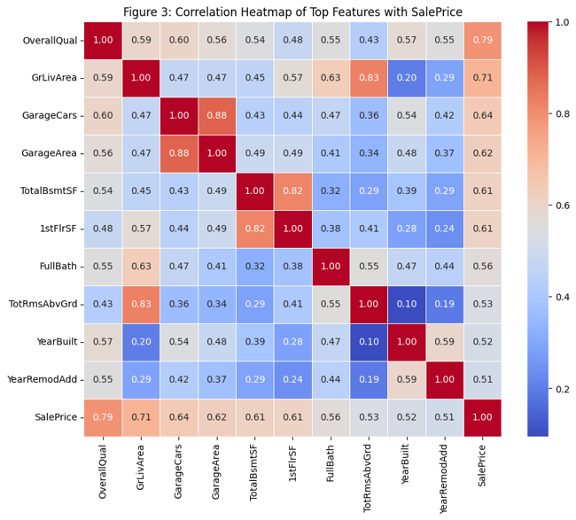
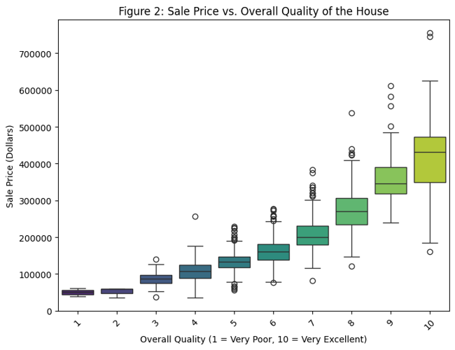

# A Data Science and Machine Learning Analysis for Housing Patterns in Ames, Iowa

**Deeba Raine**
Western Kentucky University
5/3/2026

---

## 1. Abstract

This study uses data science and machine learning techniques to predict residential property sale values using the Ames Iowa Housing dataset. The primary purpose of this study was to determine what factors influence the price of houses for sale in a specific region in Ames, Iowa. The dataset underwent the process of data wrangling, which included looking for missing values, exploratory data analysis, and feature engineering. The only variable that required imputation in this dataset was LotFrontage, which is a measurement of a house's width across the street. This column was imputed using neighborhood medians. Furthermore, a TotalSF column was feature engineered and added to the dataset to measure the whole living area, including the basement, as opposed to the previous column, which only measured above ground level.

The choice to visualize certain top features was driven by the correlation heatmap. The heatmap was created first as part of the exploratory research, and it revealed that one specific quality component had the highest association with the target variable, with living area factors following closely behind. These two groupings of attributes were obviously the strongest numerical predictors in the dataset. Three machine learning models were trained and tested: Random Forest, Linear Regression, and Ridge Regression. We compared models using MAE, RMSE, and R² Score. Random Forest outperformed all other models with a R² of 0.8270, indicating that tree-based models excel at capturing complicated, non-linear relationships in real estate data.

---

## 2. Dataset Description

The Ames Iowa housing dataset is real dataset that was created by the Ames City Assessor's Office and includes data used to calculate values for individual residential properties/ houses sold in Ames, Iowa between 2006 and 2010.

This dataset contains information about residential homes, with an emphasis on characteristics that may affect sale prices. It includes information about each home's physical structure, such as overall quality and condition, total square footage across floors and basement, above-ground living area, and number of rooms, bathrooms, bedrooms, and kitchens. Exterior parameters such as roof style and material, exterior covering, brick veneer, and foundation type are all noted. Garage dimensions include car capacity, square space, and finish. Lot characteristics include acreage, form, configuration, and linear feet of street frontage. Finally, transaction-specific details such as sale type and sale condition give context, with the objective variable being each property's ultimate sale price in dollars.

This is a population dataset, meaning it contains complete housing records for the entire geographic area rather than a sampled subset. The dataset contains 82 variables/ columns and 2930 observations/ rows whereas 27 columns has null/missing values and 55 columns with nonempty values. The dataset covers a continuous time period from 2006 to 2010, which increases its reliability and enhances data quality. The variables are classified into four types: 23 nominal, 23 ordinal, 14 discrete, and 20 continuous, and they cover a wide variety of property attributes that a normal house buyer would find significant.

Only one of the 27 columns, Lot Frontage, has missing values, while the remaining 26 variables have no data because it was not acquired during the observation.
So, for data wrangling, we deal with one missing, 26 non-existent columns, and one missing value column represented by NA within an integer datatype.
The integer type none existent value is already defined by 0, whereas the string type none existent value values are specified by NA.
Thus, Lotfrontage is the only column that requires imputation.

---

## 3. Methodology

This project followed a structured data science pipeline consisting of four stages: data wrangling, data visualization, machine learning modeling, and model evaluation.

---

## 4. Data Wrangling

### 4.1 Exploratory Data Analysis

The data wrangling process included exploratory data analysis to identify missing, redundant, and incorrect data.
This technique assisted in identifying entries with blank fields, superfluous duplicate information, and logically incorrect values.
Addressing these flaws made the dataset more accurate and suitable for reliable analysis.

### 4.2 Imputation

LotFrontage contains true missing values representing unrecorded lot width measurements. These values were imputed using the median LotFrontage within each neighborhood to preserve local spatial patterns, with global median used as a fallback.

### 4.3 Feature Engineering

Total square footage was engineered as a combined feature representing the total usable living area of a house. The column was named as "TotalSF" in the dataset. This is a strong predictor of housing price because real estate value is primarily driven by total livable space rather than individual floor distributions.

A new column "TotalSF" which stands for total square feet was added to the dataset which is the combination of square foot of basement, first floor and second floor (if not exist combined with 0 as dataset none existent values). Total square footage is an important feature in housing dataset because the price of house in real state is determined by total livable space.

---

## 5. Visualizations

### 5.1 Histogram

This visualization shows the more houses are mid priced. The peak price for houses are around 150000.

The Y-axis shows the frequency of houses and the X-axis shows different price points. The figure shows the distribution of SalePrice. The data is **right-skewed**, meaning most homes are concentrated at lower price points (around $150,000), with a long tail extending to more expensive homes (up to ~$600,000).

### 5.2 Scatter Plot

This figure shows the areas above ground (basement not covered). This figure shows that houses that has large areas excluding the basement is leaning towards higher price, which indicates a positive relationship between living area (excluding basement) and housing price, where increases in usable above-ground space generally correspond to an increase in property value. In simple words, larger the living area of a building, the higher is the price.

This figure is similar to the previous figure. The only difference is that instead of square foot (excluding basement), this model covers the entire square foot area including basement. This feature is the product of feature engineering I applied to. This figure shows houses with basements tend to follow a similar pricing pattern, but with a modest upward shift in value, especially for larger properties, which means housing having basements are reinforcing the observation that additional usable space relates to higher housing prices even if it is slightly. In simple words, basements do help increasing the price to some extent and is not an indifferent feature at in our dataset.

### 5.3 Matrix Plot

The above model displays a correlation heatmap of the top ten numerical characteristics that are most closely linked to SalePrice. OverallQual (correlation ≈ 0.80) is the biggest predictor, suggesting that a home's material and finish quality are the main factors influencing its market value. Strong positive associations (0.60–0.71) are also shown by living area parameters (GrLivArea, 1stFlrSF, TotalBsmtSF), indicating that larger residences are more expensive. Furthermore, the heatmap shows that GarageCars and GarageArea have strong multicollinearity (≈0.88), indicating that these features collect redundant information. Our model selection process is informed by this graphic, which also verifies our feature selection approach. The heatmap clearly shows that **Overall Quality (OverallQual)** is the single most important feature predicting house price.

### 5.4 Box Plot Model

This figure displays a box plot that illustrates the connection between SalePrice and OverallQual (Overall Quality). The plot shows a strong, monotonic positive relationship: both the median price and the whole price range rise significantly when the quality rating rises from 1 (Very Poor) to 10 (Very Excellent). The median price significantly increases between quality levels 7 and 8 (about $170,000 to $210,000) and once more between levels 8 and 9 ($210,000 to $290,000). At higher quality levels, the price spread also increases significantly, suggesting that although quality is the primary factor influencing price, additional characteristics (such as living space, garage, and basement) also affect high-end homes. Outliers are generally seen at higher quality levels, signifying exceptionally expensive residences.

The figure demonstrates a strong, positive, and almost linear relationship between a house's overall material and finish quality and its sale price. As quality increases from "Very Poor" (1) to "Very Excellent" (10), the median sale price rises consistently. This confirms OverallQual is a powerful predictor, justifying its use in the models.

---

## 6. Machine Learning Models

Three machine learning models were used for prediction of house prices: Random Forest (tree-based model), Linear Regression, and Ridge Regression. These models were trained and evaluated to compare performance in predicting SalePrice.

### 6.1 Random Forest

Random Forest is a collective tree-based model that constructs numerous decision trees from random subsets of data and averages their predictions. It can capture complex non-linear correlations between features and the target variable without requiring feature scaling, making it ideal for datasets with a large number of heterogeneous features, such as the Ames Housing dataset.

### 6.2 Linear Regression

Linear Regression is a baseline statistical model that assumes a linear relationship between the input features and the target variable. It was trained on scaled features using StandardScaler to ensure all features contributed equally to the model. While interpretable and computationally efficient, it may underperform when the true relationship between features and price is non-linear.

### 6.3 Ridge Regression

Ridge Regression is a regularized extension of Linear Regression that adds a penalty term (alpha = 10) to the loss function to reduce the impact of multicollinear features. Given the high correlation observed between GarageCars and GarageArea, Ridge Regression was selected as a stronger alternative to standard Linear Regression for this dataset.

---

## 7. Evaluation Metrics

The three machine learning models were evaluated using three metrics: mean absolute error (MAE), root mean squared error (RMSE), and R² score.

### 7.1 Mean Absolute Error (MAE)

MAE calculates the average absolute difference between forecast and actual sale prices. It provides a clear dollar amount indicating how far off the model's predictions are on average. A lower MAE suggests improved model performance.

### 7.2 Root Mean Squared Error (RMSE)

RMSE is similar to MAE, but corrects greater errors more heavily by squaring the differences prior to averaging. This makes RMSE more sensitive to outliers, which is important in a housing dataset because a few very high or low prices might have a big impact on model performance. A reduced RMSE suggests improved performance.

### 7.3 The R² Score (Coefficient of Determination)

R² indicates how well the model explains the variation in sale prices. It goes from 0 to 1, with 1 indicating that the model accurately predicts every sale price and 0 indicating that the model explains none of the volatility. A higher R² value implies a better fitting model.

These three criteria, used together, provide a thorough perspective of each model's accuracy and reliability. MAE and RMSE evaluate prediction error in dollar terms, making them easily interpretable in the context of house prices. R² measures the total explanatory power of each model. By comparing all three measures for Random Forest, Linear Regression, and Ridge Regression, we can identify which model best forecasts house selling prices in the Ames Iowa dataset.

---

## 8. Results and Analysis

The three machine learning models were evaluated using MAE, RMSE, and R² Score on the 20% test set (292 samples). The results are summarized in the table below:

| Model             | MAE ($) | RMSE ($) | R² Score  |        |
| ----------------- | -------------------- | ---------- | ------ |
| Random Forest     | $19,178.80           | $32,009.16 | 0.8270 |
| Linear Regression | $21,260.53           | $47,160.57 | 0.6244 |
| Ridge Regression  | $21,203.57           | $47,030.87 | 0.6265 |

Random Forest was the best performing model with the lowest MAE of $19,178.80, the lowest RMSE of $32,009.16, and the highest R² score of 0.8270. This suggests that the model explains about 82.70% of the variation in house sale prices, making it the most accurate predictor of the three. Its excellent performance is expected given that Random Forest captures complex non-linear correlations between attributes and pricing, which are typical in real estate data.

Ridge Regression had a slightly lower RMSE of $47,030.87 and a higher R² of 0.6265 than Linear Regression, which had an RMSE of $47,160.57 and R² of 0.6244. Ridge's regularization lowers the influence of multicollinear features, resulting in a slight improvement. The heatmap shows that GarageCars and GarageArea are significantly correlated (≈0.88). However, both models explained only about 62% of the variation, demonstrating that linear models are unable to completely capture the intricacy of home price trends in this dataset.

Overall, Random Forest is the best model for predicting house sale prices in the Ames Iowa dataset since it performs significantly better on all three evaluation metrics.

---

## 9. Conclusion

This experiment used three machine learning models to forecast residential property sale values from the Ames Iowa Housing dataset. After cleaning the data and engineering essential parameters, Random Forest was the highest performing model with a R² of 0.8270, indicating it explains about 83% of the variation in house prices. Linear Regression and Ridge Regression performed similarly, but fell short of Random Forest, with R² scores of roughly 0.62. Overall, the findings suggest that house prices in Ames, Iowa are most strongly influenced by the home's overall quality and total living area, and that Random Forest is the best model for this type of prediction assignment.
